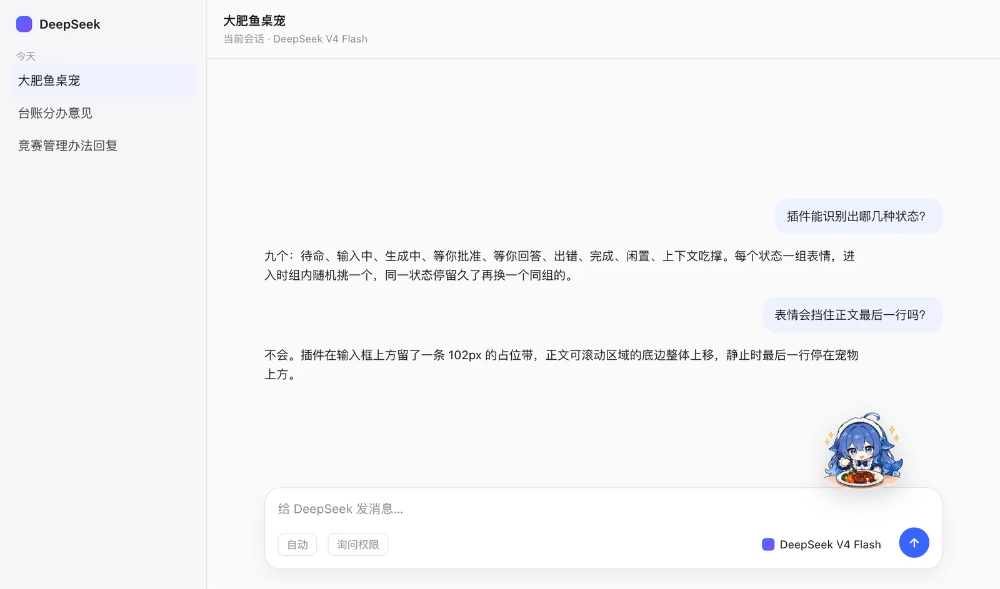
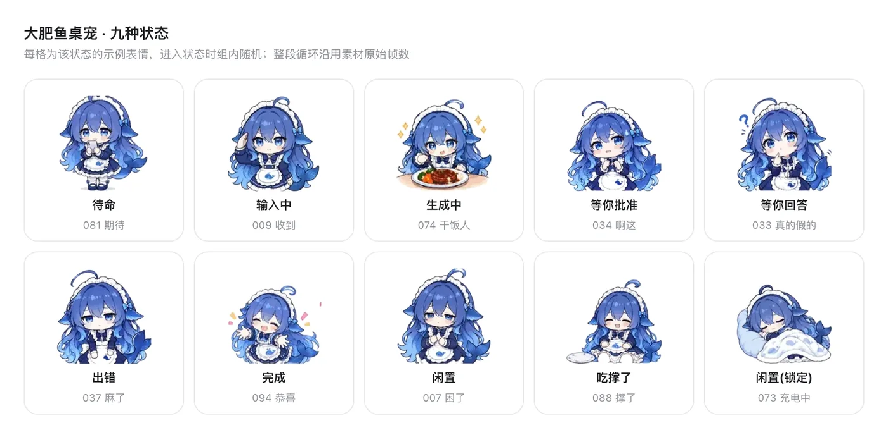
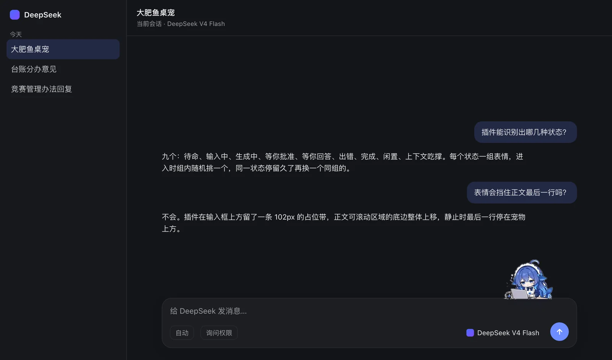

> **本插件全程由 DeepSeek Harness（DSH）+ DeepSeek V4.1 Flash 开发与维护：100% 纯 AI 生成，人工代码 0 添加。**

# 大肥鱼桌宠（dsh-fatfish）

DSH 会话框右上角的大肥鱼动画形象，按当前状态换表情：待命、输入、生成、等你批准、等你回答、出错、完成、闲置、上下文吃撑了。

表情取自 diwer/ai-biaoqingbao 的 100 张大肥鱼表情，按状态分组、组内随机；每张沿用素材原始帧数与帧序，合成一张动画 WebP 内嵌在 `client.js` 里，不依赖外部资源。



九种状态各一组表情，进入状态时随机挑一个：



暗色主题下同样贴边，不挡输入框与发送按钮：



## 状态与表情

| 状态 | 判定 | 表情组 |
|---|---|---|
| 待命 | 不在跑、失焦、静默 < 180s | 081 期待 · 019 在吗 |
| 输入中 | 输入框获得焦点 | 009 收到 · 020 来了 · 022 马上到 |
| 生成中 | `SessionSnapshot.running` | 074 干饭人 · 075 先吃一口 · 065 赶工中 · 076 咖啡续命 |
| 等你批准 | `pendingInteraction.kind === 'approval'` | 034 啊这 · 028 拜托了 · 021 等一下 |
| 等你回答 | `pendingInteraction.kind === 'question'` | 033 真的假的 · 049 尊嘟假嘟 · 093 确认眼神 |
| 出错 | `promptError` / `lastAgentError` / `openError`（8s） | 037 麻了 · 036 我裂开了 · 069 我太难了 |
| 完成 | 回合结束后 6s | 094 恭喜 · 003 点赞 · 091 满血复活 · 047 拿捏了 |
| 闲置 | 失焦、静默 ≥ 180s | **脚本**：`064 摸鱼中`/`044 不想说话` 随机开场 → 120s 后 `007 困了`×3 圈 → `018 晚安`×2 圈 → `073 充电中` 锁定 |
| 吃撑了 | 上下文占用 ≥ 85% 且失焦 | 088 撑了 · 072 让我缓缓 |

优先级：出错 > 待批准/待回答 > 生成中 > 完成（6s）> 吃撑了 > 输入中 > 闲置 > 待命。

每次进入状态从组内随机取一个；同一状态停留超过 **45 秒（±25% 抖动）** 自动换一个同状态表情，避免一个表情挂一整天；组里只剩一张时不轮换。

## 摆放

- 宠物贴在输入卡片上沿外侧、距右边 40px，缩放后约 96px 见方，不挡输入框与发送按钮。
- 所有表情在合成阶段按**底部基线对齐**，端碗、坐桌前这类宽构图也不会浮起来，贴着卡片上沿。
- 同时注册一条透明占位带（`conversation.input.dock`，高 102px）：正文可滚动区域整体上移，静止时最后一行停在宠物上方，不被遮挡。
- 闲置是脚本不是池子：`064`/`044` 随机开场，进入闲置 120 秒后按序播 `007`（3 次循环）、`018`（2 次循环），然后锁定 `073` 不再切换，直到离开闲置。循环次数烘进动画 WebP 的 loop 字段，播完停在最后一帧，切换时机由 JS 按 `帧数 × 帧时长 × 圈数` 对齐。

## 安装

### 推荐：让 agent 安装

把下面这段话交给任意能执行命令的 agent（DSH、Claude Code 等），它会完成克隆、登记、重启与验收：

```
安装 dsh-fatfish：
1. git clone https://github.com/kabarryo/dsh-fatfish.git ~/dsh-fatfish（已有目录则 git pull）
2. 把该目录登记为 profile 的插件：dependencies 里加 "dsh-fatfish": "link:/Users/<你>/dsh-fatfish"，
   并把 "dsh-fatfish" 追加到 dsh.profile.bundles 末尾
3. 重启对应的 DSH（Web 版重启 dsh web，桌面版退出重开）
4. 打开任意会话，确认输入框右上方出现大肥鱼，发一条消息确认生成时换表情
```

比手动安装省事的地方：agent 能自己定位 `~/.dsh/profiles/*`、判断 Web 还是桌面版、改前备份 `package.json`、重启并验收。手动安装最容易漏的一步是重启——bundle 只在启动时加载。

### 手动安装

要求：

- DSH 0.2.x（Web 或桌面版 profile）
- 不需要额外依赖；`client.js` 已内嵌全部表情

```bash
git clone https://github.com/kabarryo/dsh-fatfish.git ~/dsh-fatfish
```

编辑目标 profile 的 `package.json`（Web：`~/.dsh/profiles/web`，桌面版：`~/.dsh/profiles/desktop`）：

```json
{
  "dependencies": {
    "dsh-fatfish": "link:/Users/<你>/dsh-fatfish"
  },
  "dsh": {
    "profile": {
      "bundles": ["...", "dsh-fatfish"]
    }
  }
}
```

然后重启 DSH。插件只挂在会话输入区，不需要配置项，也没有 Host 侧逻辑。

## 卸载

从 profile 的 `package.json` 里删掉 `dependencies.dsh-fatfish` 与 `dsh.profile.bundles` 中的 `"dsh-fatfish"`，重启 DSH；`~/dsh-fatfish` 按需保留或删除。

## 结构

```
package.json            bundle 清单（dsh.bundle.patch + dsh.client）
cordis.patch.yml        insert: fatfish-mascot
index.js                Host 半边，空实现
client.js               构建产物：overlay 挂宠物 + dock 挂占位带，内含全部帧（约 1 MB）
src/client.template.js  源码模板（状态机、轮换、闲置脚本、CSS）
assets/raw/diwer/       29 张挑好的原始表情（已裁掉卡片底色）
assets/manifest.json    素材分组与帧索引
assets/screenshots/     README 截图（按插件 1:1 几何渲染，非真机截图）
scripts/build_emotes.py 抠底、裁切、底部对齐、导出逐帧 WebP
scripts/build_plugin.py 逐帧合成动画 WebP 并内联进 client.js
locale/{en,zh}.json     插件页标题与描述
icon.svg                自绘图标
```

## 构建与更新

```bash
# 1) 从素材重建帧（改过分组或素材时）
python3 scripts/build_emotes.py
# 2) 把帧打进 client.js
python3 scripts/build_plugin.py
```

`client.js` 变更后刷新页面即可（client bundle 按 mtime 增量读取，不用重启）；改 `package.json` / `cordis.patch.yml` 才需要重启。

## 限制

- 表情挂在输入卡片上沿，只在会话页可见；侧栏、插件页没有。
- “吃撑了”依赖 `contextPressure` 投影，窗口大小与阈值（85%）都是本插件自己的判断，DSH 没有对应状态。
- 表情组写死在 `scripts/build_emotes.py` 的 `POOLS` 里，换表情要改脚本后重跑两步构建。
- 素材本身部分画面顶部被裁（原图如此），呆毛不完整的情况已按原样保留。
- 只用 `conversation.input.overlay` + `conversation.input.dock` 两个 slot，上游改 slot 名需要同步。

## 素材许可

代码 MIT；表情素材来自 **diwer/ai-biaoqingbao**（大肥鱼表情包，CC BY-NC-SA 4.0：非商业、署名、同协议共享），角色设计 ZipZipPipe、上善无形。内嵌的动画帧属于对素材的修改版本，同样不可商用。完整说明见 [NOTICE](NOTICE)。
